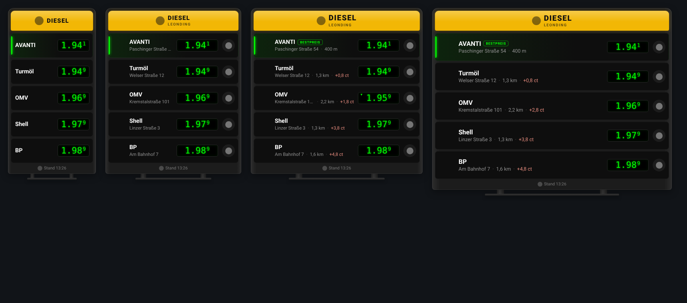

# Tankstellen Preismast · Fuel Price Pylon

[Deutsch](#deutsch) · [English](#english)



---

## Deutsch

Lovelace-Karte für Home Assistant, die Spritpreise im Look einer Tankstellen-Preissäule anzeigt. Sie passt sich der Kartenbreite an und funktioniert auf Handy, Tablet und Wandpanel. Karte und Editor erscheinen automatisch auf Deutsch oder Englisch, je nach Sprache in Home Assistant.

### Funktionen
- Preissäule mit Krone (Spritart und Ort), Mast, LED-Preistafeln und Standfuß
- Letzte Preisstelle hochgestellt wie an der Säule (1.94⁹), dazu schwach leuchtende LED-Hintergrundsegmente
- Bestpreis markiert, Differenz zum Bestpreis in Cent, Entfernung von deinem Zuhause
- Navigations-Button für Google Maps, Apple Karten oder Waze
- Trendpfeil und kurze Animation, wenn sich ein Preis ändert
- Antippen einer Zeile öffnet die Details der Entity
- Visueller Editor, geeignet für das Sections-Dashboard

### Voraussetzungen
Sensoren mit fortlaufender Nummer, z. B. aus einer Spritpreis-Integration (E-Control):
`sensor.<name>_1` bis `_5` für Diesel und `_6` bis `_10` für Super. Die Attribute `name` und `location` (Adresse, Koordinaten) werden genutzt, wenn vorhanden.

### Installation über HACS
1. HACS öffnen, oben rechts ⋮ → **Benutzerdefinierte Repositories**.
2. `https://github.com/irmscher123/tankstelle-card` eintragen, Typ **Dashboard**.
3. **Tankstellen Preismast** installieren und den Browser bzw. die App neu laden.

Manuelle Installation: `tankstelle-card.js` nach `/config/www/` kopieren und als Ressource `/local/tankstelle-card.js` (Typ JavaScript-Modul) hinzufügen.

### Beispiel
```yaml
type: custom:tankstelle-card
base_entity: sensor.leonding
fuel_type: diesel        # diesel | super
count: 5
location_name: Leonding
```

### Optionen
| Option | Standard | Beschreibung |
|---|---|---|
| `base_entity` | – | Basisname der Sensoren, ohne `_1` (Pflicht) |
| `fuel_type` | `diesel` | `diesel` (Sensoren 1–5) oder `super` (6–10) |
| `count` | `5` | Anzahl Tankstellen (1–5) |
| `location_name` | – | Untertitel, wird aus Namen und Adressen entfernt |
| `title_override` | – | eigener Titel |
| `card_color` | `#1c1c1c` | Farbe des Masts |
| `accent_color` | automatisch | Farbe der Krone (Diesel gelb, Super grün) |
| `led_color` | `#00ff00` | Farbe der LED-Preise |
| `logo_base` | Repo | eigener Logo-Pfad, z. B. `/local/tankstelle/logos/` |
| `decimal_separator` | `.` | `.` oder `,` |
| `price_font_size` | `22` | Schriftgröße der Preise in px |
| `price_box_min_width` | `104` | Mindestbreite der Preisanzeige in px |
| `superscript_digit` | `true` | letzte Stelle hochgestellt |
| `ghost_digits` | `true` | LED-Hintergrundsegmente |
| `show_header` | `true` | Krone anzeigen |
| `show_logos` | `true` | Logos anzeigen |
| `show_rank` | `false` | Platznummer am Logo |
| `show_base` | `true` | Standfuß anzeigen |
| `show_updated` | `true` | Aktualisierungszeit anzeigen |
| `highlight_cheapest` | `true` | Bestpreis hervorheben |
| `show_diff` | `true` | Differenz zum Bestpreis in Cent |
| `show_distance` | `true` | Entfernung von Zuhause |
| `show_navigation` | `true` | Navigations-Button |
| `nav_provider` | `google` | `google`, `apple` oder `waze` |
| `trend_minutes` | `60` | so lange bleibt der Trendpfeil sichtbar (0 = aus) |
| `animate_changes` | `true` | Animation bei Preisänderung |
| `up_color` / `down_color` | rot / grün | Leuchtfarbe bei steigendem / fallendem Preis |
| `pulse_scale` / `glow_strength` | `1.045` / `1.0` | Stärke der Animation |

### Logos und Schrift
- Logos liegen im Ordner [`logos/`](logos/) und werden über jsDelivr geladen. Eigene Logos: `logo_base` auf einen eigenen Pfad setzen.
- Die LED-Schrift ist optional: `triple_dot_digital-7.ttf` nach `/config/www/fonts/` legen. Ohne sie wird eine Monospace-Schrift verwendet.

---

## English

Lovelace card for Home Assistant that shows fuel prices styled like a petrol station price pylon. It adapts to the card width and works on phones, tablets and wall panels. The card and its editor switch automatically between German and English, following your Home Assistant language.

### Features
- Price pylon with a crown (fuel type and location), mast, LED price panels and a base
- Last digit shown as superscript like on a real pylon (1.94⁹), plus faintly lit LED background segments
- Best price highlighted, difference to the best price in cents, distance from your home
- Navigation button for Google Maps, Apple Maps or Waze
- Trend arrow and a short animation when a price changes
- Tapping a row opens the entity's more-info dialog
- Visual editor, works in the sections dashboard

### Requirements
Numbered sensors, e.g. from an Austrian fuel price integration (E-Control):
`sensor.<name>_1` to `_5` for diesel and `_6` to `_10` for petrol (Super). The attributes `name` and `location` (address, coordinates) are used when available.

### Installation via HACS
1. Open HACS, top right ⋮ → **Custom repositories**.
2. Add `https://github.com/irmscher123/tankstelle-card`, type **Dashboard**.
3. Install **Tankstellen Preismast** and reload your browser or app.

Manual installation: copy `tankstelle-card.js` to `/config/www/` and add it as a resource `/local/tankstelle-card.js` (type JavaScript module).

### Example
```yaml
type: custom:tankstelle-card
base_entity: sensor.leonding
fuel_type: diesel        # diesel | super
count: 5
location_name: Leonding
```

### Options
| Option | Default | Description |
|---|---|---|
| `base_entity` | – | Base name of the sensors, without `_1` (required) |
| `fuel_type` | `diesel` | `diesel` (sensors 1–5) or `super` (6–10) |
| `count` | `5` | Number of stations (1–5) |
| `location_name` | – | Subtitle, removed from names and addresses |
| `title_override` | – | Custom title |
| `card_color` | `#1c1c1c` | Mast colour |
| `accent_color` | automatic | Crown colour (diesel yellow, petrol green) |
| `led_color` | `#00ff00` | Colour of the LED prices |
| `logo_base` | repo | Custom logo path, e.g. `/local/tankstelle/logos/` |
| `decimal_separator` | `.` | `.` or `,` |
| `price_font_size` | `22` | Price font size in px |
| `price_box_min_width` | `104` | Minimum width of the price display in px |
| `superscript_digit` | `true` | Last digit as superscript |
| `ghost_digits` | `true` | LED background segments |
| `show_header` | `true` | Show the crown |
| `show_logos` | `true` | Show logos |
| `show_rank` | `false` | Rank number on the logo |
| `show_base` | `true` | Show the pylon base |
| `show_updated` | `true` | Show update time |
| `highlight_cheapest` | `true` | Highlight the best price |
| `show_diff` | `true` | Difference to the best price in cents |
| `show_distance` | `true` | Distance from home |
| `show_navigation` | `true` | Navigation button |
| `nav_provider` | `google` | `google`, `apple` or `waze` |
| `trend_minutes` | `60` | How long the trend arrow stays visible (0 = off) |
| `animate_changes` | `true` | Animate price changes |
| `up_color` / `down_color` | red / green | Glow colour for rising / falling prices |
| `pulse_scale` / `glow_strength` | `1.045` / `1.0` | Animation strength |

### Logos and font
- Logos live in the [`logos/`](logos/) folder and are loaded via jsDelivr. For your own logos, set `logo_base` to your own path.
- The LED font is optional: put `triple_dot_digital-7.ttf` into `/config/www/fonts/`. Without it a monospace font is used.
